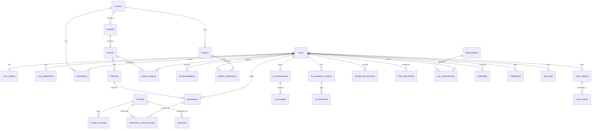

# Database Design (PostgreSQL)

Conventions: UUID primary keys, created_at/updated_at (timestamptz) on all tables, snake_case, FKs indexed,
soft delete (deleted_at) only for user-generated content; curriculum uses archived flag. Alembic migration per change.
Deletion rules: user deletion cascades personal data (progress, submissions, conversations); curriculum rows are
RESTRICT when referenced by learner data (archive instead).

## Entities (spec list) and additions
users, user_profiles, user_preferences, courses, modules, lessons, enrollments, lesson_progress, exercises,
submissions, projects, project_submissions, ai_conversations, ai_messages, ai_assistance_sessions, ai_interactions,
code_artifacts, code_reviews, architecture_decisions, skill_assessments, achievements, certificates, notifications, audit_logs.

Additions needed by the spec:
- concepts (id, slug, name, category A|B|C): taxonomy for weakness analysis and competency.
- content_concepts (content_type, content_id, concept_id): tags lessons/exercises/projects.
- submission_concept_results (submission_id, concept_id, correct, total): per-concept scoring.
- resources (id, title, url, kind youtube|article|docs|repo, concept_id, level, is_open_source, approved_by): curated recommendations.
- recommendations (user_id, source_submission_id, target_type lesson|resource, target_id, reason, status).
- user_achievements (user_id, achievement_id, earned_at); user_competencies (user_id, concept_id, level, evidence_count).
- ai_usage_counters (user_id, day, tokens_in, tokens_out, requests): rate and cost limits.
- puzzles may reuse exercises with type='puzzle' and a JSON definition.

## Key relationships (ER)

## Constraints and indexes (highlights)
- users.email unique (case-insensitive via citext or lower() index); role enum student|instructor|admin.
- enrollments unique(user_id, course_id); lesson_progress unique(user_id, lesson_id).
- modules unique(course_id, position); lessons unique(module_id, position); slugs unique within parent.
- submissions index(user_id, exercise_id, created_at desc); ai_messages index(conversation_id, created_at).
- CHECK constraints on score ranges (0 to 100), assistance mode enum (1 to 5), status enums.
- Passwords stored only as hashes; never in logs or audit payloads.

## Implemented in Phase 2 (migration 0001)
users, user_profiles (PK = user_id, one-to-one), refresh_tokens (sha256 hash only, family_id for reuse detection),
audit_logs (JSONB details, actor SET NULL on user delete). Naming convention is defined in app/models/base.py.
CHECK constraints enforce role, lowercase email and experience level in the database itself.

## Implemented in Phase 3 (migration 0002)
concepts, courses (kind stage|track, stage_number), modules, lessons (status published|planned, content_md, JSONB objectives and principles),
lesson_concepts, enrollments, lesson_progress, user_competencies.
Integrity rules in the database: a lesson is published if and only if it has content; a progress row is completed if and only if it has completed_at;
stage courses have a stage_number and tracks do not. Curriculum rows referenced by learner data use ON DELETE RESTRICT.
Deviations from the Phase 0 design: lesson_concepts replaces polymorphic content_concepts (exercise concepts get their own table in Phase 4);
position columns are indexed, not unique, so content can be reordered during a seed.
